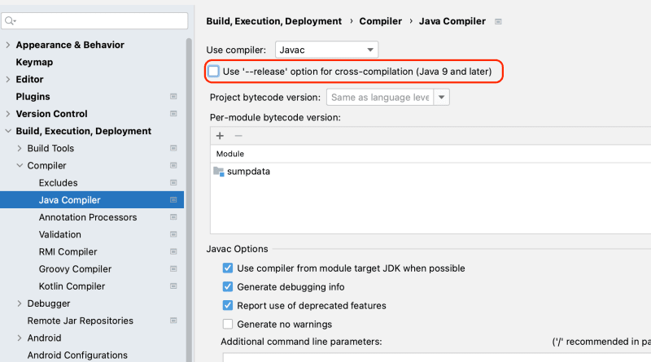

With the recent release of Java 21 LTS (September 2023), one of the welcome additions is [JEP 431: Sequenced Collections](https://openjdk.org/jeps/431). It introduces a uniform way to access the first and last elements of collections via methods like `List#getFirst()` and `List#getLast()`, rather than relying on `list.get(0)` or iterator workarounds.

However, after updating a project to JDK 21 in IntelliJ IDEA, you might run into an unexpected compiler error when trying to call these new methods.

## The Error: java: cannot find symbol

In the IntelliJ editor, the code may appear valid if the Project SDK is configured for JDK 21. But when building the project, `javac` fails:

```text
java: cannot find symbol
  symbol:   method getFirst()
  location: interface java.util.List<String>
```

## Why This Happens: The `--release` Flag

In Java 9+, `javac` introduced the `--release <N>` option. Unlike the older `-source` and `-target` flags (which only checked language syntax and emitted specific bytecode without restricting available platform APIs), `--release` compiles against the historical API signature database (`ct.sym`) for the target version.

If an existing IntelliJ project was originally configured for Java 17, IntelliJ's compiler settings may still enforce `--release 17`. Even though compilation runs on a JDK 21 compiler, `--release 17` forces `javac` to restrict platform symbols to the Java 17 standard library. Because `getFirst()` did not exist on `List` prior to Java 21, compilation fails.

## The Fix

To resolve this in IntelliJ IDEA:

1. Open **Settings / Preferences** (`⌘,` on macOS or `Ctrl+Alt+S` on Linux/Windows).
2. Navigate to **Build, Execution, Deployment** -> **Compiler** -> **Java Compiler**.
3. Under the **Javac Options** section, locate the **Use '--release' option for cross-compilation** setting.
4. Either:
   - Ensure the **Project bytecode version** and per-module target bytecode versions are set to `21`.
   - Or uncheck the **Use '--release' option for cross-compilation** checkbox if building directly against the JDK 21 runtime.



5. Rebuild the project (`⌘F9` / `Ctrl+F9`).

## Summary

When adopting new Java 21 APIs in IntelliJ, updating the Project SDK in **Project Structure** is only part of the configuration. If the compiler settings retain an older target version or enforce `--release` against an older API baseline, newly introduced methods like `getFirst()` will fail to resolve.
