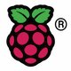
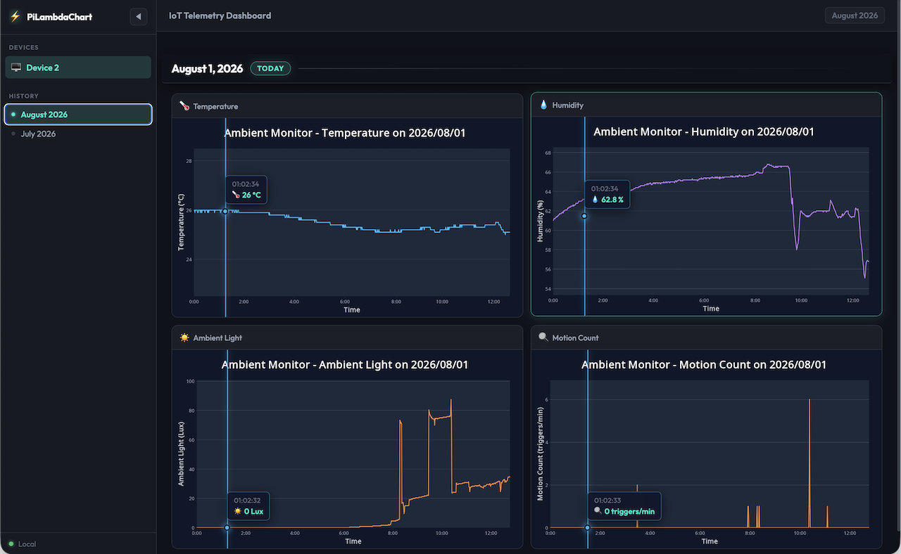
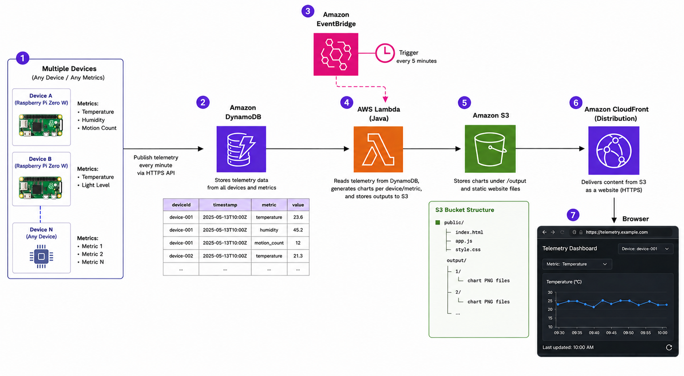
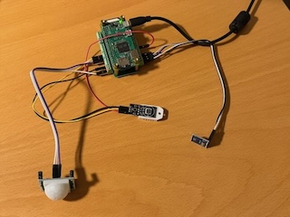
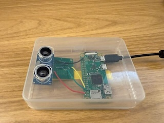

| | Technology | Role |
|:---|:---|:---|
| {:height="24"} | Raspberry Pi | Edge device (sensor host) |
| {:height="24"} | Python 3 (asyncio) | Edge agent & sensor drivers |
| {:height="24"} | Java 21 | Lambda chart generator |
| 📊 | JFreeChart | Server-side chart rendering |
| {:height="24"} | AWS Lambda | Serverless compute |
| {:height="24"} | DynamoDB | Time-series & metadata storage |
| {:height="24"} | S3 | Static file hosting |
| {:height="24"} | CloudFront | CDN & HTTPS delivery |
| {:height="24"} | EventBridge | Scheduled triggers |
| {:height="24"} | Terraform | Infrastructure as Code |
| {:height="24"} | HTML / JS | Frontend dashboard (vanilla, no framework) |
| {:height="24"} | CSS | Styling & dark theme |

I already had a serverless water level monitoring system running — a Raspberry Pi with an ultrasonic sensor uploading readings to DynamoDB, a Lambda function generating daily charts, and CloudFront serving them from S3. It worked well for that single purpose. But as I added more sensors — temperature, humidity, ambient light, motion — I realized the system was too tightly coupled to water level monitoring. The metric names, chart styles, and dashboard layout were all hardcoded for one use case. I wanted to rebuild it as a **generic, multi-device telemetry platform** that could handle any number of sensors and metrics, with a modern interactive UI — while preserving the serverless architecture that kept costs near zero.



## Github Repo

The full project is open source: [github.com/nobudev7/PiLambdaChart](https://github.com/nobudev7/PiLambdaChart)

The README walks through setting up each layer. If you have a Raspberry Pi with a DHT22 sensor and an AWS account, you can have a working dashboard in about an hour.

## The Architecture

The system is split into four decoupled layers, each independently deployable and scalable:



1. **Edge (Raspberry Pi + Python)** — An async Python daemon reads sensors at configurable intervals and writes readings to DynamoDB. Failed uploads are buffered in a memory-capped retry queue and flushed automatically when connectivity returns.

2. **Storage (DynamoDB)** — Two tables: `IoT_Telemetry` for time-series data, `IoT_Metadata` for device and metric registries (names, units, chart types, icons). The telemetry table uses a composite partition key `deviceId#metricId#year` with an ISO-8601 timestamp as the sort key, which keeps partitions bounded and allows efficient daily range queries with a single `BETWEEN` operation.

3. **Processing (Lambda + EventBridge)** — A Java 21 Lambda function triggered every 5 minutes by EventBridge. It queries a day's worth of telemetry, renders dark-themed JFreeChart PNGs, generates JSON sidecar files for interactive tooltips, and uploads everything to S3.

4. **Frontend (S3 + CloudFront)** — A pure client-side SPA (no build step, no framework) that fetches a catalog index and metadata JSON, then renders chart tiles, synchronized crosshairs, and a responsive dark-mode UI. CloudFront delivers it globally with HTTPS and optional HTTP Basic Auth.

## Why Serverless

The decision to go fully serverless wasn't academic — it was economic and operational.

With a traditional approach, I would need an EC2 instance (or at minimum a container) running 24/7 to receive sensor data and serve the dashboard. For a personal monitoring project, that's $15-30/month in baseline costs plus the overhead of OS patching, uptime monitoring, and capacity planning.

With the serverless stack, the cost breakdown looks very different:

| Component | Cost Driver | Typical Monthly Cost |
|:---|:---|:---|
| DynamoDB | On-demand reads/writes | ~$0.25 |
| Lambda | 5-min invocations × 30 days | ~$0.50 |
| S3 | Storage + requests | ~$0.10 |
| CloudFront | Data transfer | ~$0.50 |
| EventBridge | Scheduling | Free tier |

**Total: ~$1.35/month** — and zero servers to maintain. The infrastructure scales with usage, not with time.

## The Edge: Sensors and Resilience



The edge agent supports multiple sensor types through a plugin architecture. Each sensor driver inherits from a `BaseSensor` class:

| Sensor | Interface | Metric |
|:---|:---|:---|
| DHT22 | GPIO | Temperature (°C), Humidity (%) |
| BH1750 | I2C | Ambient Light (Lux) |
| PIR | GPIO interrupt | Motion Count (triggers/min) |
| HC-SR04 | Ultrasonic GPIO | Water Level (cm) |



One feature I found essential in practice was the **retry queue**. My basement Pi has intermittent WiFi, and without retry logic, data points were silently lost. The agent now buffers failed uploads in an `asyncio.Queue` with a configurable memory cap and automatically flushes them when connectivity is restored. In production, this has recovered hundreds of readings that would have otherwise been dropped.

The agent also auto-detects whether it's running on actual Raspberry Pi hardware. When GPIO libraries aren't available (e.g., on a Mac during development), it automatically falls back to simulated sensor data. This means the full pipeline can be tested end-to-end without physical hardware.

## Chart Generation with JFreeChart on Lambda

As a Java developer, I naturally chose Java for the Lambda function. While looking for a charting library, I found **JFreeChart** — a mature, feature-rich library in the JVM ecosystem that produces publication-quality charts. It turned out to be an excellent fit for server-side rendering of dark-themed, styled chart images.

The chart generator renders dark-themed PNGs with a custom 8-color palette designed for high contrast against the slate background. Similar hues are spread apart across metric IDs so that adjacent metrics always have visually distinct colors:

```
Metric 1 → Sky Blue     Metric 5 → Purple
Metric 2 → Rose         Metric 6 → Teal
Metric 3 → Emerald      Metric 7 → Amber
Metric 4 → Orange       Metric 8 → Fuchsia
```

Alongside each PNG, the Lambda generates a **JSON sidecar** file containing the exact plot area boundaries and per-point data coordinates. This is the key to the frontend's interactive crosshairs — the browser can calculate sub-pixel-accurate tooltip positions by mapping mouse coordinates onto the chart's data space using these boundary values.

## The Frontend: Zero Dependencies, Full Interactivity

The dashboard is a single-page application built with zero frameworks, zero build tools, and zero server-side rendering. The entire frontend is three files: `index.html`, `style.css`, and `app.js`.

On load, the browser fetches two files from S3:
- `file-list.json` — a catalog of all available charts organized by device, metric, year, and month
- `metadata.json` — device names, metric names, units, emoji icons, and chart configurations

From these, the app constructs the full sidebar navigation and chart tile grids entirely client-side. This means serving the dashboard costs essentially nothing — CloudFront delivers static files, and there is zero compute at view time.

The interactive features include:
- **Synchronized crosshairs** across all metric charts for the same day
- **Data tooltips** with time and value, snapped to the nearest data point
- **Full-screen lightbox** for detailed chart inspection
- **Deep-linking** via URL parameters (`?device=1&year=2026&month=08&day=14`)
- **Day-of-week color coding** — Sunday in red, Saturday in blue

## Infrastructure as Code

The entire AWS stack is defined in Terraform with feature flags for incremental deployment:

```hcl
enable_lambda           = true
enable_cloudfront       = true
enable_metadata_seeding = true
```

This means you can deploy DynamoDB tables first, start collecting data, then add Lambda chart generation later, and finally enable CloudFront when you're ready to go public. Each layer can be toggled independently.

Device and metric definitions live in `terraform.tfvars` (which is gitignored), keeping personal device names and locations out of the repository:

```hcl
seeded_devices = {
  "1" = { name = "Sump Pump Monitor", location = "Basement" }
  "2" = { name = "Ambient Monitor",   location = "Bedroom" }
}
```

## What I Learned

Building PiLambdaChart reinforced a few principles:

**Event-driven architectures are naturally resilient.** Each component — edge agent, DynamoDB, Lambda, S3, CloudFront — operates independently. If Lambda fails, the data is still in DynamoDB waiting. If the edge goes offline, the retry queue catches it. There's no single point of failure.

**Pre-rendered assets beat real-time rendering for dashboards.** By generating charts as static PNGs on a schedule rather than rendering them in the browser on each page load, the dashboard loads instantly from a CDN cache. The JSON sidecar approach gives us the best of both worlds — static delivery with interactive overlays.

**Serverless doesn't mean simple.** The infrastructure has real complexity: IAM least-privilege policies, DynamoDB partition key design, CloudFront cache behaviors, and Terraform state management. But that complexity lives in the infrastructure definition, not in day-to-day operational burden. Compared to running your own server, there's much less to worry about — no OS patching, no uptime monitoring, no capacity planning.


