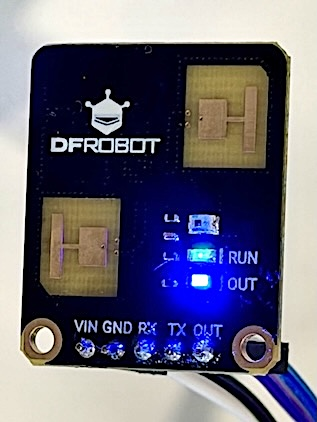

## Open Source Links

* **GitHub Repository**: [github.com/nobudev7/c4002-python](https://github.com/nobudev7/c4002-python)
* **PyPI Package**: [pypi.org/project/c4002-python/](https://pypi.org/project/c4002-python/)
* **Issue Tracker**: [github.com/nobudev7/c4002-python/issues](https://github.com/nobudev7/c4002-python/issues)

---
## Technologies used

| Component | Technology | Role |
|:---|:---|:---|
| Hardware | Raspberry Pi | Host controller & UART interface |
| Sensor | DFRobot C4002 (SEN0691) | 24GHz FMCW mmWave human presence radar |
| Language | Python 3.8+ | Driver, CLI utilities, and telemetry decoder |
| Packaging | Hatchling / pyproject.toml | PEP 517/621 build backend |
| CI/CD & Release | GitHub Actions + PyPI OIDC | Automated testing, linting, and Trusted Publishing |

## Motivation
Traditional PIR (Passive Infrared) motion sensors are the standard choice for smart lighting and home automation, but they have a fundamental limitation: they only detect gross movement. If you sit still, a PIR sensor doesn't report any movement.

To achieve **true human presence detection**, 24GHz millimeter-wave (mmWave) FMCW radar sensors work very well. They can detect micro-motions as subtle as human respiration and chest expansion up to 10 meters away.

Recently, I integrated the **DFRobot C4002 (SEN0691)** mmWave sensor into my Raspberry Pi home monitoring setup. However, while DFRobot provides an Arduino C++ library, there wasn't a pip-installable Python package available for Linux and Raspberry Pi developers. 

I decided to build **`c4002-python`** from the ground up, test it thoroughly on actual hardware, and publish it as an open-source package on [PyPI](https://pypi.org/project/c4002-python/) and [GitHub](https://github.com/nobudev7/c4002-python).



---

## The Hardware: DFRobot C4002 (SEN0691)

The C4002 is a compact 24GHz FMCW radar module that operates between 3.6V and 5.5V with 3.3V TTL UART logic:

* **Micro-Motion & Static Presence**: Detects sitting, breathing, or sleeping individuals up to 10 meters.
* **Motion Tracking**: Measures target distance, speed, signal energy (0–100), and direction (`Approaching` vs `Moving Away`) up to 11 meters.
* **Ambient Light Sensor**: Onboard photosensor rated for 0–50 Lux, useful for dusk-to-dawn lighting triggers.
* **Configurable Distance Gates**: 80cm or 20cm resolution gates with customizable sensitivity thresholds.
* **Dual Output Modes**: Standard 115200 baud UART protocol plus a digital `OUT` GPIO pin.

### Wiring to Raspberry Pi

Connecting the C4002 to a Raspberry Pi's 40-pin GPIO header requires only 4 or 5 jumper wires:

```
  Raspberry Pi GPIO Header                  DFRobot C4002
 ┌─────────────────────────┐               ┌─────────────┐
 │ Pin 2  [5V]             ├───────────────┤ VIN         │
 │ Pin 6  [GND]            ├───────────────┤ GND         │
 │ Pin 8  [GPIO 14 / TXD]  ├───────────────┤ RX          │
 │ Pin 10 [GPIO 15 / RXD]  ├───────────────┤ TX          │
 │ Pin 11 [GPIO 17]        ├───────────────┤ OUT (opt)   │
 └─────────────────────────┘               └─────────────┘
```

---

## Decoding the 32-Byte Binary UART Protocol

The C4002 continuously streams 32-byte binary notification frames at 115200 baud. The frame layout is structured as follows:

1. **Header (4 bytes)**: Fixed synchronization pattern `0xFA 0xF5 0xAA 0xA5`.
2. **Length (2 bytes, LE)**: Total packet length (`0x0020` = 32 bytes).
3. **Control (2 bytes)**: Reserved byte `0x00` and message type (`0x04` for Notification).
4. **Command ID (1 byte)**: `0x60` for live detection telemetry or `0x03` for background noise calibration status.
5. **Inner Payload**:
   * Target Status (`0 = No Target`, `1 = Static Presence`, `2 = Motion`)
   * Ambient Light Intensity (uint16 LE, scale `0.1 Lux`)
   * Active Distance Gate bitmask (uint32 LE)
   * Presence Disappearance Countdown (uint16 LE, seconds)
   * Presence Distance (uint16 LE cm) & Energy (uint8, 0–100)
   * Motion Distance (uint16 LE cm), Speed (signed int16 LE cm/s), Energy, and Direction
6. **Checksum (2 bytes, LE)**: 16-bit sum of all preceding bytes (`sum(bytes[:-2]) & 0xFFFF`).

### Real-World Engineering Challenges

Building a production-ready driver required solving several practical hardware quirks:

### 1. Zero-Lag Hardware Synchronization
While using `time.sleep()` between reads was convenient at the beginning, it introduced serial buffer lag because the sensor streams telemetry continuously. For efficiency and real-time responsiveness, `read_packet()` blocks directly on the incoming UART stream until the next validated frame arrives:

```python
# Paced directly by the sensor hardware clock
data = sensor.read_packet()
```

Letting the hardware clock pace the read loop eliminates buffer backlog and keeps CPU usage near zero.


### 2. Dark / Stealth Mode (Turning Off Onboard LEDs)
The C4002 module features two bright onboard LEDs: a blue `RUN` status LED and an `OUT` detection indicator. In a bedroom or office, the bright blue LED can be distracting.

By analyzing the module's protocol command `CMD_SET_LED_MODE = 0xA1`, I implemented software-controllable LED states:
```python
# Stealth mode: completely turn off both LEDs over UART
sensor.turn_off_leds()

# Or toggle them individually
sensor.set_run_led(False)
sensor.set_out_led(False)
```
Both example scripts also expose CLI flags (`--led-off` and `--led-on`) for instant toggling.

### 3. Automatic Background Noise Calibration
High-frequency 24GHz radar waves reflect off stationary room objects (metal cabinets, ceiling fans, moving curtains). The sensor includes a built-in background noise learning routine (`CMD_ENV_CALIBRATION = 0x60`). The library exposes:
```python
sensor.start_env_calibration(delay_time=10, cont_time=30)
```
This gives you 10 seconds to exit the room, after which the sensor samples background reflections for 30 seconds and writes custom noise thresholds to prevent false triggers.

### 4. 1-Minute Windowed Time-Series Aggregation
Checking presence every 60 seconds directly risks missing transient events (e.g., someone walking through a room for 15 seconds). I added a windowed aggregator (`examples/minute_aggregator.py`) that continuously monitors the sensor at 1 Hz and exports 1-minute summaries (`occupancy_pct`, `avg_distance_m`, `max_motion_energy`, `avg_light_lux`) into CSV format, ready for Grafana or home dashboard charting.

---

## Packaging and CI/CD Pipeline

To ensure the library is reliable and maintainable, I set up modern Python packaging and automation standards:

### 1. Modern Build System with `pyproject.toml`
Instead of legacy `setup.py`, the package uses PEP 517/621 with [Hatchling](https://hatch.pypa.io/):
* Strict metadata and type hints.
* Optional Raspberry Pi GPIO support via extra: `pip install "c4002-python[gpio]"`.
* Fast linting with **Ruff** configured to Python 3.8+ targets.

### 2. Multi-Version Testing on GitHub Actions
A GitHub Actions test workflow runs on every push and pull request, executing test suites across Python **3.8, 3.9, 3.10, 3.11, and 3.12** on Ubuntu runners using captured live sensor packet fixtures.

### 3. Publishing to PyPI via Trusted Publishers (OIDC)
Instead of storing permanent PyPI API tokens in GitHub repository secrets, `c4002-python` uses PyPI's **Trusted Publisher** mechanism.

When a new version tag (e.g. `v0.2.0`) is published on GitHub, GitHub Actions generates an OpenID Connect (OIDC) cryptographic token. PyPI verifies the token directly against the repository identity (`nobudev7/c4002-python`) and workflow (`publish.yml`), building and publishing the source distribution (`.tar.gz`) and wheel (`.whl`) without any manual secrets.

---

## Getting Started

### Installation

Install directly from PyPI:

```bash
# Standard installation
pip install c4002-python

# With Raspberry Pi GPIO OUT pin support
pip install "c4002-python[gpio]"
```

### Quick Example

```python
from c4002 import C4002Sensor

# Connect to Raspberry Pi hardware UART (/dev/serial0)
with C4002Sensor(port="/dev/serial0") as sensor:
    # Optional: disable onboard LEDs for dark environments
    sensor.turn_off_leds()

    print("Monitoring presence. Press Ctrl+C to stop...")
    while True:
        data = sensor.read_packet()
        if data and not getattr(data, "is_calibrating", False):
            print(f"State: {data.target_state_name} | Light: {data.ambient_light_lux} Lux")
            if data.presence_detected:
                print(f"  Presence Distance : {data.presence_distance_m} m (Energy: {data.presence_energy}/100)")
                if data.motion_distance_m > 0:
                    print(f"  Motion Tracking   : {data.motion_distance_m} m at {data.motion_speed_m_s} m/s ({data.motion_direction_name})")
```

---


If you're building a Raspberry Pi presence detection project, give it a spin and feel free to open an issue or pull request!
