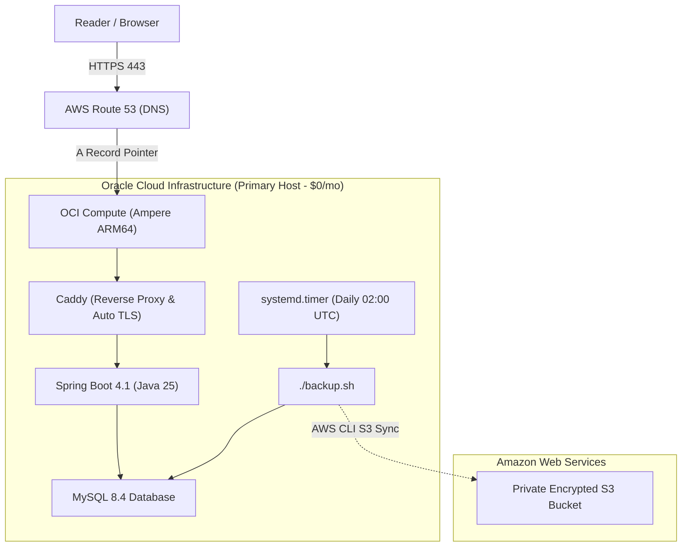

## Motivation: Beyond Single-Vendor Lock-In

When I built and deployed [Marginalia](https://github.com/nobudev7/marginalia)—my private, self-hosted RSS reader web application—**AWS Lightsail** was the natural starting point. For $7.00/month, Lightsail provided a simple, self-contained VPS with a bundled static IP and firewall. Paired with Docker Compose and Caddy for automated Let's Encrypt TLS, it worked reliably and without fuss.

However, relying entirely on a single cloud vendor introduces subtle technical trade-offs. As cloud offerings mature, different hyperscalers develop distinct strengths. For compute-heavy or persistent personal workloads, exploring alternative cloud providers—specifically **Oracle Cloud Infrastructure (OCI)** and its modern Ampere Altra ARM64 architecture—presented an exciting opportunity.

While cutting operational costs from ~$7/month to **$0/month** through OCI's Always Free tier was a welcome catalyst, the true engineering objective was broader: **architectural vendor neutrality**. 

I wanted Marginalia’s infrastructure to treat compute providers as interchangeable commodities. If AWS Lightsail, OCI, Hetzner, or a bare-metal server can run Docker, our Infrastructure as Code (IaC) and deployment workflows should support switching between them in minutes—without risking DNS misconfigurations or touching long-lived backup storage.

---

## The Architecture: Decoupling Compute, Routing, and Backups

In monolithic Terraform repositories, compute instances, DNS records, and backup storage buckets often live inside the same `main.tf` and share a single state file. 

This tight coupling is dangerous during cloud migrations: running `terraform destroy` to decommission an old server risks accidentally destroying your DNS zones or wiping out historical database backup buckets.

To achieve clean multi-vendor support, I restructured Marginalia's deployment layout into **four decoupled stacks**, each with an independent lifecycle and isolated Terraform state:

```text
deploy/terraform/
├── README.md                 # Architecture matrix & deployment quickstart
├── aws-lightsail/            # Compute Option 1: AWS Lightsail (~$7/mo)
├── oci/                      # Compute Option 2: Oracle Cloud ($0/mo Always Free ARM)
├── dns-route53/              # Independent Routing: Route 53 A-record pointer
└── backup-s3/                # Cross-Cloud DR: Encrypted S3 bucket & retention policy
```

### 1. Pure Provider Isolation
- `deploy/terraform/oci/` depends **exclusively** on `oracle/oci`. It has zero AWS dependencies and requires no dummy AWS credentials.
- `deploy/terraform/aws-lightsail/` depends exclusively on `hashicorp/aws`.
- `deploy/terraform/dns-route53/` is simply a routing pointer. It takes a generic `target_ip` variable (derived from whichever compute stack is active) and updates the subdomain `A` record.
- `deploy/terraform/backup-s3/` manages an encrypted, private S3 bucket with 90-day lifecycle retention. It remains 100% untouched whether compute is hosted on AWS, OCI, or elsewhere.

### 2. Zero Application Code Changes
Because Docker base images (Ubuntu, Eclipse Temurin Java 25, Node.js 22, Caddy, MySQL 8.4) publish multi-architecture manifests supporting both `linux/amd64` and `linux/arm64`, the exact same `compose.yaml`, `Caddyfile`, environment configuration, and database scripts run identically on both AWS (x86_64) and OCI (ARM64).

### 3. Component & Technology Stack

| Component | Technology | Role |
|:---|:---|:---|
| **Primary Cloud (Compute & Networking)** | Oracle Cloud Infrastructure (OCI) | Ampere Altra ARM64 compute (`VM.Standard.A1.Flex`), VCN, Reserved Static IPv4 |
| **Secondary Cloud (DNS & Disaster Recovery)** | Amazon Web Services (AWS) | Route 53 (subdomain routing) & S3 (encrypted off-site backups) |
| **Infrastructure as Code** | Terraform (v1.5+) | Decoupled multi-provider stacks (`aws-lightsail/`, `oci/`, `dns-route53/`, `backup-s3/`) |
| **Container Orchestration** | Docker Engine & Compose v2 | Multi-arch container runtime (`linux/amd64` and `linux/arm64`) |
| **Reverse Proxy & TLS** | Caddy v2 | Automated Let's Encrypt ACME TLS, HTTP/3, and SPA static hosting |
| **Application Stack** | Spring Boot 4.1 (Java 25) + React 19 + MySQL 8.4 | Self-hosted RSS reader ([Marginalia](https://github.com/nobudev7/marginalia)) |

---

## Cross-Cloud Resilience: The Real Win

By combining OCI and AWS, Marginalia now operates with true **cross-cloud resilience**:



- **Compute & Ingestion**: Handled by OCI’s high-performance Ampere Altra ARM64 instance (2 OCPUs, 12 GB RAM) at zero monthly cost.
- **Off-Site Disaster Recovery**: Handled by AWS S3. Daily compressed database backups are automatically pushed to an encrypted S3 bucket with automated 90-day lifecycle expiration. Even in the worst-case scenario of an OCI tenancy loss, not a single feed subscription or article bookmark is lost.
- **Portability**: If another cloud provider emerges in the future, adding a sibling directory under `deploy/terraform/` (e.g. `gcp-compute/` or `hetzner/`) requires only defining the VM and pointing `dns-route53` to its IP.

---

## Key Takeaways

1. **Multi-cloud isn't just for large enterprises**: With modular Terraform stacks and Docker containerization, even solo developers and personal open-source projects can achieve cloud vendor independence without excessive complexity.
2. **Decouple state early**: Separating compute from long-lived assets (DNS, storage, IAM) eliminates migration friction and prevents costly accidental deletions.
3. **ARM64 is fully production-ready**: Moving a modern Java 25 LTS (Spring Boot 4.1) backend and React 19 frontend from x86_64 to ARM64 was entirely seamless—zero code modifications, zero build issues, and flawless container parity.
4. **Resilience through diversification**: Running compute on one cloud while keeping encrypted backups on another gives you enterprise-grade disaster recovery while taking advantage of the best pricing each vendor offers.

---

## Appendix: The Migration Journey (Step-by-Step Operations)

For those interested in the operational mechanics, state surgery, and cutover commands, here is the detailed technical walkthrough.

### Phase 1: Non-Destructive State Separation

Before touching any live infrastructure, I refactored the monolithic AWS state offline. Using `terraform state mv`, 10 existing AWS resources were split into the three new modular directories:

```bash
# Example: Moving Route 53 record into dns-route53 state
terraform state mv \
  -state=deploy/terraform/terraform.tfstate \
  -state-out=deploy/terraform/dns-route53/terraform.tfstate \
  aws_route53_record.marginalia aws_route53_record.marginalia
```

Running `terraform plan` on all three stacks afterward confirmed **`0 added, 0 changed, 0 destroyed`**—proving that the directory refactoring had zero impact on the live production server.

### Phase 2: Building the OCI Infrastructure Stack

Next, I wrote `deploy/terraform/oci/` to provision the new environment. Key technical solutions included:

1. **VCN & Security Lists**: OCI requires provisioning a dedicated Virtual Cloud Network (VCN), Internet Gateway, Route Table, and Subnet. The Security List explicitly allows ingress for SSH (port 22), HTTP (port 80), and HTTPS (port 443 TCP/UDP).
2. **Host-Level `iptables` Rules**: OCI’s official Ubuntu images include restrictive host `iptables` rules that drop incoming traffic on ports 80 and 443 by default, regardless of the VCN Security List. In `user-data.sh.tftpl`, cloud-init automatically inserts `ACCEPT` rules before the default Ubuntu `REJECT` rule:
   ```bash
   iptables -I INPUT 6 -p tcp --dport 80 -m state --state NEW -j ACCEPT
   iptables -I INPUT 6 -p tcp --dport 443 -m state --state NEW -j ACCEPT
   netfilter-persistent save
   ```
3. **Dynamic Image Lookup**: Rather than hardcoding image OCIDs (which change with every OS release), Terraform dynamically queries the latest Canonical Ubuntu 24.04 image matching the target architecture (`aarch64` for Ampere ARM).
4. **Persistent Reserved Static IP**: Allocated an Always Free Reserved Public IPv4 address (`oci_core_public_ip`) to ensure the host retains a fixed public IP across reboots and maintenance.

### Phase 3: The Zero-Downtime Live Cutover

With the OCI instance provisioned and bootstrapped (Docker Engine, 2 GB swapfile, fail2ban), we performed the cutover:

1. **Pre-Staging**: Cloned the repository to `/opt/marginalia` on the OCI host, copied `deploy/.env`, and pre-built the containers in parallel while the AWS Lightsail instance was still serving live traffic.
2. **Data Consistency**: Paused the backend service on Lightsail to freeze database writes, generated a compressed database snapshot (`marginalia_backup.sql.gz`), transferred it to OCI, and restored it using `./deploy/restore.sh`. All 2,508 articles, 16 feeds, 9 categories, and Flyway schema migrations were verified intact.
3. **DNS Repointing**: Updated `target_ip` in `deploy/terraform/dns-route53/terraform.tfvars` from the Lightsail IP to the OCI Reserved Static IP and executed `terraform apply`.
4. **Automated TLS Issuance**: Within 60 seconds of the DNS record propagating, Caddy on OCI automatically solved the ACME HTTP-01 challenge and obtained a fresh Let's Encrypt TLS certificate for `marginalia.nobudev7.com`.
5. **Rollback Safety Net**: Rather than immediately deleting the AWS Lightsail VM, it was left stopped but fully intact for a 24–48 hour observation window. If any subtle issue arose on ARM64, reverting a single line in `dns-route53/terraform.tfvars` would restore the entire AWS stack instantly.
