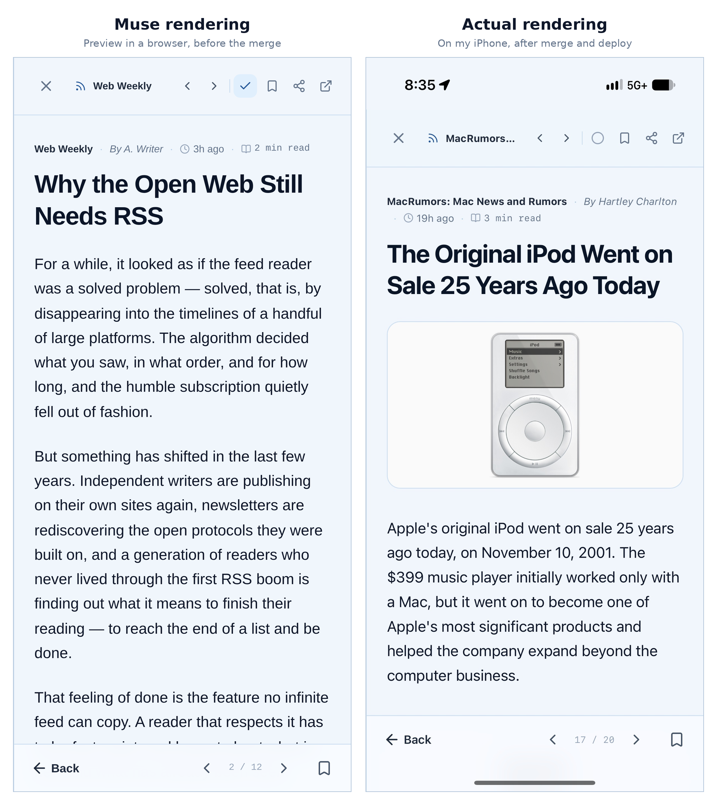

## Motivation: An Assistant With Its Own Computer

Most AI coding tools live inside your editor or your terminal. **Muse** (Meta's personal AI agent) is different in one important way: it comes with its own Linux VM — a real shell, a browser, persistent storage. So I asked a simple question about [Marginalia](https://github.com/nobudev7/marginalia), my self-hosted RSS reader:

> Can Muse act as a coding agent for this repo — clone it on its VM, build, test, push a branch, and open a pull request — while I only direct and review?

The alternative (read/edit access to a single folder on my Mac) has no shell behind it — no `git`, no Maven, no tests. I chose the VM clone.

One framing note for everything below: **all terminal work happened inside Muse's VM. I never typed those commands, and I didn't see most of them at the time** — I saw requests, results, and summaries in chat. The commands quoted in this post are reconstructed from Muse's reports.

---

## Setup: What I Asked vs. What Muse Figured Out

**What I asked:** clone this repo on your VM, and verify the build the way CI does.

**What Muse did on its own:**

- Installed the matching JDK and verified both parts — the frontend passed immediately.
- When Java's network access was blocked, identified the exact Muse permission setting causing it and the single destination to allow (Maven Central), then waited for me to change it.
- When the backend test run showed 26 failures out of 143, traced them to one cause: the VM's DNS returns synthetic `198.18.0.0/15` addresses, which Marginalia's SSRF validator blocks *by design*. Fixed it with a JVM-only hosts workaround — **zero repository changes** — and all 143 tests passed.
- When GitHub SSH on port 22 timed out through the VM's gateway, switched to SSH over port 443.

**Rules I set before any real work** (my only other setup input):

1. **Never push to `main`. Always a branch**, with an agent-specific prefix.
2. **For UI changes, show me a visual before pushing.**
3. **Agent commits must be distinguishable from mine**: me as author, the agent in the committer field plus a `Co-authored-by` trailer. Muse first picked a committer address that turned out to belong to a real, unrelated GitHub user — it caught this itself via the API, switched to a local-only address that links to no account, and re-verified.

---

## Who Does What: One-Time, Every Task, Automatic

The clearest way to summarize the whole experiment:

| | What | When |
|:---|:---|:---|
| **My intervention (one-time)** | Switch the network permission to "Ask" and approve Maven Central · Add Muse's SSH key as a **deploy key on this repo only** · Connect the official GitHub connector (OAuth) and select **marginalia only** for the GitHub App | Setup only — done once, reused by every future task |
| **My intervention (every task)** | Describe the task and constraints · Approve the visual (for UI work) · Approve the merge · Deploy on my server (`git pull` + rebuild the frontend container) | Per task |
| **Automatic (Muse)** | Clone, toolchain setup, build, lint, tests · Branch, commit (with the identity scheme above), push · Screenshots for review · Open the PR, check CI status | Per task, no input from me |

The one-time items are done exactly once. After that, each task is the third row plus a few approvals from me.

---

## The First Task: A Button My Thumb Can't Reach

**What I asked:** on my iPhone 17 Pro, Marginalia's article reader is full-screen and the only close control is a ~32 px X in the top-left corner. Evaluate first: (1) a button at the bottom, (2) a swipe gesture, or (3) something else.

**What Muse figured out:** it read the actual component, ruled out swipe-up (it conflicts with the reading scroll), pointed out that a footer button only helps at the end of an article, and recommended a fixed mobile bottom bar plus a 44 px close target.

**What I decided:** do bottom bar plus a 44 px close target — but show me the visual before any push.

Muse implemented it locally, rendered the real component in a browser at the phone's viewport (402 × 874), and sent full-screen screenshots (at rest / mid-scroll / end of article). I approved, and it pushed the branch.

{: style="max-height: 550px;"}

The change itself is one file — details are in the commit: [the merged commit on `main`](https://github.com/nobudev7/marginalia/commit/160850a766f36e9ffb720573c1c3d5fee289f717) and [PR #38](https://github.com/nobudev7/marginalia/pull/38).

**Merging, as I asked:** squash and merge, keeping the full commit message. Muse checked CI first (backend ✔, frontend ✔), merged through the connector, and afterwards I deployed with `git pull` + `docker compose up -d --build caddy` — frontend-only, a fact Muse confirmed from the compose file rather than assumed.

---

## Creating the PR: Three Failed Approaches, Then the Working One

Pushing the branch took seconds. Opening the PR took much longer:

1. **Browser automation** — hit GitHub's sign-in wall; a full account session in an agent's browser is broader access than I wanted to hand over. I stopped it.
2. **`gh`** — installed but not logged in, and Muse's vault deliberately never provides stored tokens to shell tools. So `gh` could not be used.
3. **A fine-grained token I pasted in chat** — scoped to one repo, used exactly once to create PR #38, deleted by me right after. It worked, but a token in a chat log is not a pattern to repeat.
4. **The official GitHub connector** — OAuth + the Muse GitHub App, with repository selection (marginalia only). No token exists anywhere. This was available from the start; neither of us checked the connector catalog first. Lesson recorded.

---

## Open Question: What Else Is This VM For?

One thing I genuinely don't know yet, and want to test next: **how far does this VM generalize?**

- **A different repository?** Presumably yes — another clone, another deploy key, another line in the repo-selection list. Nothing in the setup was Marginalia-specific except the JDK version.
- **A different purpose entirely?** For example, scheduled jobs: a script that runs every morning — checking CI status, watching a feed, compiling a report — and messages me only when something matters. The VM persists between conversations, which is exactly what scheduled work needs.

Both are unverified. If they work, the VM stops being "where the coding agent lives" and becomes a small always-on machine that happens to have an AI operator.

---

## Key Takeaways

1. **The bottleneck was never code generation** — it was setting up access permissions and verifying results. The one-time setup column above is where the time went.
2. **Constraints make autonomy reviewable**: branch-only pushes, a distinct committer identity, and a screenshot approval step made supervision a few approvals.
3. **Use the narrowest credential that does the job.** In increasing order of scope: repo-scoped deploy key < repo-scoped token < app installation on selected repos < full account session.
4. **"Tests are failing" ≠ "code is wrong"** — here the sandbox DNS was returning incorrect addresses to the JVM, and the fix belonged to the environment, not the repo.
5. **Check the platform's first-party options first.** The official connector was more secure *and* less work than every workaround that preceded it.
